# הצעת מבנה לאתר חברותא

**סטטוס:** טיוטה לאישור. אין שינוי בקוד או בעיצוב עד שאישור מפורש יתקבל.

**בסיס הביקורת:** האתר החי [חברותא](https://dudidd-wq.github.io/chavruta-app/) וקוד `main` ב־`chavruta-app` (commit `7c42917`, 15.11.2026 בשעה 15:10 שעון ישראל). הביקורת נעשתה בקריאת הנתיבים, הניווט, תבניות העמודים והתוכן שבאוויר — בלי יישום.

העמוד הראשי הוא סימפטום: יש באתר יותר מדי כניסות מקבילות לאותו תוכן, ניווט עמוס, ועמודים חשובים (ספרייה, ביאורים, מפתח) קבורים — במיוחד בנייד.

---

## 1. מצב קיים

### 1.1 ניווט

סרגל עליון (מחשב) בונה **11 פריטים** מ־`NAVITEMS`, ועוד כלים מסביב:

| פריט | כתובת | בסרגל התחתון בנייד |
|---|---|---|
| ראשי | `#/home` | כן |
| שערי לימוד | `#/learn` | לא — ב«עוד» |
| מקורות | `#/sources` | לא |
| עץ הידע | `#/tree` | כן |
| מפתח עניינים | `#/topics` | לא |
| ספרים | `#/books` | לא |
| ספרייה | `#/read` | לא |
| לימוד יומי | `#/daily` | כן |
| מה חדש | `#/new` | כן |
| מצב המערכת | `status.html` | לא |
| חיפוש | פותח לוח חיפוש מהיר, לא עמוד | כן |

מסביב לניווט, באותו סרגל: לוגו, בורר פרשה, כפתורי אחורה/קדימה, קיצורי «מפתח» ו«ספרים», מתג שלושת מצבי העבודה (קריאה / קשרים / חקר), בורר צבעים, התאמה אישית, ייצוא PDF. בנייד יש גם פס טיוטה עליון וסרגל תחתון של חמישה פריטים + «עוד».

התוצאה: במסך צר התוויות נעלמות (כבר מתחת ל־1400 פיקסלים), הסרגל יורד לשתי שורות מתחת ל־1100, ובנייד **הספרייה, הביאורים, שערי הלימוד והמפתח אינם בשורת הניווט הראשית**.

### 1.2 כל העמודים והנתיבים

האפליקציה היא עמוד יחיד (`index.html`) עם ניתוב האש. רשימת התצוגות ב־`VIEWS`:

| נתיב | עמוד | הערה |
|---|---|---|
| `#/home` | שער האתר | כרטיסי כל הפרשיות, חיפוש, מדדים, מדף אישי, שערי לימוד, ספרייה, יומי, חדשות, עץ, מפתח, הסבר מצבים |
| `#/learn`, `#/learn/<שער>`, `#/learn/<שער>/<עוגן>` | שערי לימוד | חמישה שערים (פרשה, מועד, תפילה, חז״ל, יסודות). בפועל כמעט ריק: 3 עוגנים ו־2 שיוכים |
| `#/biurim` | ספר הביאורים של בראשית | רשימת 47 ביאורים |
| `#/parsha/<שם>` | עמוד פרשה | לפרשות שאינן בראשית: שרשראות + מיפוי מקורות |
| `#/biur/<מזהה>` | קורא ביאור | מצבי קריאה / קשרים / חקר; באנר בקרה |
| `#/sheets`, `#/sheets/<מזהה>` | דפי שיעור | לא בניווט הראשי |
| `#/read`, `#/read/<סדרה>`, `#/read/<סדרה>/<עמוד>` | ספרייה — טקסט מלא | 34 סדרות, 43,609 עמודים (קה״ת, ספריית חב״ד) |
| `#/books`, `#/books/...` | מדף ספרים | כרטיסי מהדורות וצילומי שער על בסיס עץ הידע — **לא** הקורא |
| `#/tree`, `#/tree/r/<רבי>`, `#/tree/s/...`, `#/tree/b/...` | עץ הידע | 57,455 יחידות, 122 סדרות, 9 דורות (מהבעש״ט עד הרבי) |
| `#/tree/k` | עץ הקבלה | זהר, האריז״ל, פרדס, של״ה וכו׳ |
| `#/tree/m` | מפות לפי מקום | מועדים, נ״ך, תחומים |
| `#/topics`, `#/topics/<ערך>` | מפתח עניינים | כולל הפניות ביבליוגרפיות לספר הערכים (בלי הטקסט עצמו) |
| `#/sources`, `#/item/<מזהה>` | טבלת מקורות וכרטיס פריט | מסננים לפי פרשה, דור, שנה, סטטוס |
| `#/daily` | לימוד יומי | תניא יומי, תורה אור ולקוטי תורה |
| `#/new` | מה חדש בעולם החסידות | פיד יומי מאתרים במעקב |
| `#/search` | תוצאות חיפוש | פריטים, ביאורים, קטעי מקור, עץ, ספרייה, דפי שיעור |
| `#/about` | אודות ושיטת העבודה | לא בניווט הראשי |
| `#/study` | הלימוד שלי | מקומות קריאה שמורים בדפדפן |
| `#/notebook` | מחברת וגיבוי | הערות אישיות |
| `#/saved` | המקורות שלי | |
| `#/later` | לקריאה בהמשך | מתוך «מה חדש» |
| `#/status`, `#/coverage`, `#/closure`, `#/map` | תצוגות מחקר | מופנים ללשוניות בתוך עמוד פרשה במצב חקר |

עמודים נפרדים (לא בניתוב האש):

- `status.html` — מצב המערכת (כיסוי, קשרים, בקרת איכות). עמוד תפעולי באתר הציבורי.
- `404.html`
- תיקיות סטטיות ישנות של שרשראות: `noach/`, `lech-lecha/`, `vayera/`, `chayei-sarah/`, `toldot/`, `vayetze/`, `vayishlach/` — עותקים לצד האפליקציה.

**אין עמוד כרונולוגיה** (ציר זמן מהבעש״ט עד הרבי) ככניסה עצמאית. «ציר הזמן» מופיע רק כמפת מקורות בתוך ביאור, במצב חקר.

### 1.3 איך התוכן מאורגן היום

**ביאורים ושיעורים.** ליבת האתר התחילה כספר ביאורים לפרשת בראשית (47 ביאורים). נוספו שרשראות מבוארות בפרשות נח עד תולדות/וישלח (טיוטות בחלקן), ודפי שיעור נפרדים. 54 פרשיות רשומות באתר; לרוב יש רק מיפוי מקורות מעץ הידע, בלי ביאור. «שערי לימוד» אמור לארגן את אותו חומר לפי מועד, תפילה, חז״ל וסוגיה — אבל השערים כמעט ריקים, והכניסה העיקרית נשארה רשימת הפרשיות בשער.

**ספרים — שלושה מדפים מקבילים.**

1. **ספרייה (`#/read`)** — קורא טקסט מלא: 34 סדרות קה״ת (כתר שם טוב עד אגרות קודש, כולל מלוקט ותורת מנחם). אין בה עדיין את ספר הערכים, ואין אוסף קונטרסי קה״ת (למעט «קונטרס ומעין» כספר בודד).
2. **ספרים (`#/books`)** — מדף מהדורות עם צילומי שער, מצב מיפוי, ו«רענון צילומי השער». זה קטלוג ביבליוגרפי, לא קריאה.
3. **עץ הידע (`#/tree`)** — קטלוג מיקום של יחידות (ספר, כרך, עמוד, שנה, קישור למקור). כולל גם עץ קבלה ומפות מועד/נ״ך.

שלושתם מדברים על «ספרים», וההבדל ביניהם גלוי בעיקר למי שבונה את האתר.

**מפתח עניינים.** ערכים (מושגים, אישים, זמנים, דימויים) עם מופעים בביאורים, בקטעי מקור ובעץ. בספר הערכים יש כרגע רק הפניות ביבליוגרפיות מהערות, בלי הטקסט של הסדרה.

**כרונולוגיה.** שכבת תאריכים קיימת בפרויקט (WP-024), והעץ עצמו מסודר לפי דורות. אין עמוד ציבורי שמציג ציר זמן רציף מהבעש״ט עד הרבי.

**מה חדש.** פיד יומי חי, עם כניסה בניווט ובשער. זה אחד העמודים הברורים באתר.

**לימוד יומי.** תניא / תורה אור / לקוטי תורה — כניסה נפרדת בניווט, אף שיש גם ספרייה לקריאה וגם שערי לימוד.

### 1.4 כפילויות

- **ספרייה / ספרים / עץ הידע** — שלוש כניסות ל«ספרים».
- **שערי לימוד / הפרשיות בשער / עמוד פרשה / מיפוי הפרשות בעץ** — ארבע דרכים להגיע לאותה פרשה.
- **מקורות (טבלה) / עיון במקורות בשער לימוד / מקורות בעץ / כרטיס פריט** — אותם פריטים במעטפות שונות.
- **חיפוש** — לוח מהיר (`/`), שדה בשער, עמוד `#/search`, חיפוש בעץ, חיפוש במדף, חיפוש בספרייה, סינון במפתח.
- **מצב המערכת** (`status.html`) מול סטטוס/כיסוי/סגירה בתוך האפליקציה (שמופנים למצב חקר).
- **צבעים** — כפתור ערכת צבעים בסרגל, וגם «התאמה אישית» עם אותן ערכות (ספר, תכלת, זית, ניגודיות) ועוד סגנונות.
- **הלימוד שלי / מחברת / מקורות שלי / לקריאה בהמשך** — ארבעה עמודים אישיים בלי מקום קבוע בניווט; מופיעים בשער וגם בתוך חלון ההעדפות.
- **הודעת הטיוטה** — פס עליון, הערת פוטר, ובביאורים גם באנר בקרה. חשוב להשאיר אזהרה, אך לא בשלושה מקומות בבת אחת.
- תיקיות HTML ישנות של שרשראות לצד הקורא באפליקציה.

### 1.5 מבוי סתום, תוכן חסר, ותוכן שנראה פנימי

- ספר הערכים עדיין לא בספרייה (רק הפניות במפתח).
- קונטרסי קה״ת נרשמו כמקור לעץ, אך לא כסדרה לקריאה באתר.
- אין עמוד כרונולוגיה, אף שהמשתמש מצפה לציר מהבעש״ט עד הרבי.
- שערי לימוד מבטיחים ארגון לפי נושא, ומציגים בעיקר מעטפת ריקה.
- רוב כרטיסי הפרשיות בשער מובילים ל«מיפוי מקורות, הביאורים בשלב הבא» — כניסה מאכזבת לאורח חדש.
- במדף הספרים: «רענון צילומי השער», «מקורות ששיוכם בבדיקה», «טרם מופו יחידות» — שפה של עבודת פנים.
- `status.html` הוא לוח בקרה של הפרויקט, לא כניסה ללומד.
- קיצורי מקלדת ומצבי «קשרים/חקר» מניחים שימוש במחשב.

### 1.6 חוסר אחידות בתבניות

- בראשית נפתחת ב־`#/biurim`; שאר הפרשיות ב־`#/parsha/<שם>`.
- לשער, לספרייה, לעץ, למפתח ול«מה חדש» יש מפתחות שונים (hero, מדף, כרטיסי דורות, ענן א״ב, פיד).
- עמודים אישיים ודפי שיעור פשוטים יותר, בלי אותה מעטפת.
- סימון «העמוד הנוכחי» בניווט לא מכסה את כל התצוגות (`about`, `study`, `sheets`, `notebook` וכו׳). מיפוי מוזר: `#/tree/.../p/...` מסומן כ«ראשי».

### 1.7 בעיות בנייד

דוד גולש בעיקר מהטלפון. שם הבעיה חריפה יותר:

- הסרגל העליון עמוס גם אחרי הסתרת תוויות.
- חמשת הפריטים התחתונים הם: ראשי, עץ, לימוד יומי, מה חדש, חיפוש. **חסרים הספרייה והביאורים** — שני היעדים העיקריים.
- השער ארוך מאוד: התאמת קריאה, «הלימוד שלי», שערי לימוד, כל 54 הפרשיות (ספר בראשית פתוח), ואז חמש כניסות נוספות, ואז «איך לומדים». עיקר התוכן החדש מתחת לקפל.
- חיפוש בשער קיים, אבל קל לאבד אותו בגלילה; החיפוש בסרגל התחתון פותח לוח, לא את השדה שבשער.
- מצבי העבודה וה־PDF תופסים מקום גם כשאין ביאור פתוח.

---

## 2. בעיות הליבה

1. **אין היררכיה אחת.** האתר גדל בשכבות (ביאורי בראשית → עץ → חדשות → ספרייה → שערי לימוד → מדף ספרים → התאמה אישית), וכל שכבה קיבלה כניסה בניווט.
2. **שלושה «מדפי ספרים»** מבלבלים אורח, וסדרות חדשות (ספר הערכים, קונטרסים) אין להן בית ברור.
3. **השער מנסה להיות גם הסבר, גם מפת אתר וגם רשימת פרשיות** — ולכן נראה לא מסודר.
4. **בנייד הניווט לא משקף את מטרות הלימוד**, ולכן האתר «מרגיש בנוי לא נכון».
5. **שכבות חשובות חסרות כעמוד** (כרונולוגיה) או קיימות רק כהפניה (ספר הערכים), בעוד עמודי פנים (סטטוס, רענון כריכות) בולטים מדי.

---

## 3. המבנה המוצע

### 3.1 עקרונות

- **שש כניסות לכל היותר** בניווט הראשי — זהות במחשב ובנייד.
- **חיפוש תמידי** (בשער ובסרגל) — לא פריט שביעי בניווט.
- **ספרייה אחת** לקריאה ולמדף המהדורות.
- **ביאורים ושיעורים** תחת כניסה אחת, עם באנר טיוטה ברור.
- **עץ + ציר זמן** כשני אופנים של אותו קטלוג דורות.
- **כתובות קיימות נשמרות** (הפניות), כדי שלא ישברו קישורי חוץ.
- **ערכות הצבעים, הסגנונות וההתאמה האישית נשארות** כמו שהן; משנים מבנה, לא את מנגנון העיצוב.
- האתר פונה גם למי שאינו מבית חב״ד: בשער מסבירים מהי חסידות כאן, מהו ביאור, ומה אפשר לקרוא מיד — בלי להניח היכרות עם «נשיאים», «ד״ה» או מצב «חקר».

### 3.2 ניווט עליון מוצע (שישה פריטים)

| # | תווית | מה יש בפנים | כתובת ראשית |
|---|---|---|---|
| 1 | ראשי | שער קצר: מהי חברותא, חיפוש, המשך קריאה, פרשת השבוע, כניסות | `#/home` |
| 2 | ספרייה | טקסט מלא + מדף מהדורות; כולל ספר הערכים וקונטרסי קה״ת כשייכנסו | `#/read` |
| 3 | ביאורים | שערי לימוד, פרשיות, ביאורים, דפי שיעור, לימוד יומי, הלימוד שלי | `#/learn` |
| 4 | עץ וזמן | עץ הידע לפי דורות/ספרים, וציר זמן מהבעש״ט עד הרבי | `#/tree` |
| 5 | מפתח | מפתח עניינים | `#/topics` |
| 6 | מה חדש | מה חדש בעולם החסידות | `#/new` |

**מחוץ לשישייה, בלי לאבד אותם:**

- חיפוש — כפתור/שדה קבוע (ו־`/` במחשב).
- מקורות (`#/sources`) — לשונית או כניסה מתוך העץ / הביאורים, לא פריט עליון.
- ספרים (`#/books`) — לשונית «מהדורות» בתוך הספרייה.
- לימוד יומי — כרטיס בשער + כניסה תחת ביאורים.
- אודות, מצב המערכת, התאמה אישית, PDF — בפוטר או בתפריט כלים.
- מחברת / מקורות שלי / לקריאה בהמשך — תחת «הלימוד שלי».

בנייד אותם שישה פריטים: ארבעה בסרגל התחתון (ראשי, ספרייה, ביאורים, חיפוש) ו«עוד» עם עץ וזמן, מפתח, מה חדש; או שישה בגיליון מתומצת אם יוחלט שחיפוש נשאר כפתור מרחף. ההחלטה הסופית — באישור, בשלב 1.

### 3.3 מפת אתר מוצעת

```mermaid
flowchart TB
  Home["ראשי — מהי חברותא, חיפוש, המשך, פרשת השבוע"]

  Lib["ספרייה"]
  Learn["ביאורים"]
  Tree["עץ וזמן"]
  Topics["מפתח עניינים"]
  News["מה חדש"]

  Home --> Lib
  Home --> Learn
  Home --> Tree
  Home --> Topics
  Home --> News

  Lib --> Ft["טקסט מלא: סדרות קה״ת"]
  Lib --> Erchim["ספר הערכים — כשייכנס"]
  Lib --> Kuntres["קונטרסי קה״ת — כשייכנסו"]
  Lib --> Editions["מדף מהדורות וכריכות"]
  Lib --> Reader["קורא הספר"]

  Learn --> Gates["שערים: פרשה, מועד, תפילה, חז״ל, יסודות"]
  Learn --> Parsha["עמוד פרשה / ספר ביאורים"]
  Learn --> Biur["קורא ביאור — עם באנר טיוטה"]
  Learn --> Sheets["דפי שיעור — עם באנר טיוטה"]
  Learn --> Daily["לימוד יומי"]
  Learn --> MyStudy["הלימוד שלי: מחברת, שמורים"]

  Tree --> Gens["לפי דורות: הבעש״ט עד הרבי"]
  Tree --> Chrono["ציר זמן"]
  Tree --> Kabbalah["עץ הקבלה"]
  Tree --> Places["מועדים, נ״ך, תחומים"]
  Tree --> Sources["טבלת מקורות וכרטיס פריט"]

  Topics --> Term["דף ערך"]
  News --> Item["פריט / לקריאה בהמשך"]

  Tools["פוטר וכלים: אודות, מצב המערכת, צבעים והתאמה, PDF"]
  Search["חיפוש בכל האתר"]
  Home --> Search
  Search --> Lib
  Search --> Learn
  Search --> Tree
  Search --> Topics
```

### 3.4 תבניות עמוד

שבע תבניות קבועות, עם כותרת, פתיח קצר, וניווט זהה:

1. **שער** — הסבר קצר (גם למי שאינו מבית חב״ד), חיפוש בולט, «המשך מאיפה שעצרת», פרשת השבוע, ארבע–חמש כניסות. בלי רשימת כל הפרשיות ובלי מדדי מערכת ארוכים.
2. **רחבת מדור** — כותרת, משפט מה יש כאן, כרטיסי משנה (למשל: לקריאה / מהדורות; ביאורים / לימוד יומי).
3. **עיון וסינון** — חיפוש, מסננים, רשימה או רשת (ספרייה, מדף, מפתח, מקורות).
4. **קורא** — ספר או ביאור: עמודה אחת, כלים מתכנסים, באנר טיוטה בביאורים ובדפי שיעור. ערכות הצבע וההתאמה האישית נשמרות.
5. **ציר זמן** — דורות מהבעש״ט עד הרבי, עם קפיצה לספר, ליחידה או לביאור.
6. **פיד** — «מה חדש», תאריך, מקור, שמירה להמשך.
7. **עזר** — אודות, מצב המערכת, 404, תוצאות חיפוש.

### 3.5 מסעות משתמש

**אורח חדש (גם מחוץ לחב״ד).** נכנס לשער → מבין שמדובר במערכת לימוד למאמרי חסידות, עם ביאורים ומקורות מקושרים, ועם אזהרת טיוטה אחת ברורה → מחפש מושג או פותח ספר מהספרייה / ביאור של פרשת השבוע. לא נדרש לעבור דרך עץ, סטטוס או מדף כריכות.

**לומד קבוע.** נכנס → «המשך קריאה» או לימוד יומי → קורא ביאור או ספר → שומר הערה במחברת. פרשת השבוע ושערי המועד/תפילה זמינים תחת ביאורים, לא כעולם נפרד.

**חוקר.** עובר לעץ וזמן: מחפש ד״ה, מנווט לפי דור או לפי ציר השנים, נכנס לכרטיס פריט ולטבלת מקורות, מדלג למפתח או לקורא הטקסט המלא כשהוא קיים. מצב «קשרים/חקר» נשאר *בתוך* הביאור, לא בניווט האתר.

### 3.6 שימור כתובות

כל כתובת קיימת ממשיכה לעבוד. אחרי אישור:

- `#/books` ייפתח כלשונית המהדורות בספרייה (או יופנה אליה).
- `#/daily`, `#/biurim`, `#/parsha/...`, `#/sheets`, `#/study` יישארו, ויוצגו כחלק מ«ביאורים».
- `#/sources` ו־`#/item/...` יישארו, עם כניסה מ«עץ וזמן».
- תיקיות השרשראות הסטטיות: הפניה לקורא באפליקציה, בלי מחיקה בשלב הראשון.
- `status.html` יישאר, אבל ירד מהניווט הראשי לפוטר / אודות.

### 3.7 ערכות נושא והתאמה אישית

אין בשינוי המבנה נגיעה בערכות (ספר, תכלת, זית, ניגודיות), בסגנונות, בתאורה או בהעדפות הקריאה. בשלב היישום יש להשאיר את מנגנון `personalize` ואת בדיקת `theme_smoke` ירוקים. אפשר *לאחד את שני כפתורי העיצוב* לכפתור אחד בתפריט הכלים — רק באישור, כי זה משנה הרגל קיים.

---

## 4. תוכנית מעבר בשלבים

יישום רק אחרי אישור המבנה. כל שלב — PR נפרד, בלי מיזוג בלי עיון בעיצוב.

| שלב | מה עושים | מה לא עושים |
|---|---|---|
| 0 | המסמך הזה, לאישור | שינוי ממשק |
| 1 | ניווט של שישה פריטים (מחשב + נייד), בלי לשבור כתובות | עיצוב מחדש של השער |
| 2 | שער מתומצת לפי תבנית השער שלמעלה | הוספת סדרות חדשות |
| 3 | איחוד ספרייה + מדף מהדורות תחת «ספרייה» | שינוי קורא הטקסט |
| 4 | ריכוז ביאורים, שערי לימוד, יומי ודפי שיעור תחת «ביאורים»; באנר טיוטה אחיד | כתיבת ביאורים חדשים |
| 5 | עמוד «עץ וזמן»: לשונית ציר זמן (מהבעש״ט עד הרבי) לצד העץ הקיים | שינוי מודל הנתונים של העץ |
| 6 | כניסת ספר הערכים וקונטרסי קה״ת לספרייה, כשהטקסט מוכן וראוי לפרסום | פרסום חומר שלא אושר |
| 7 | הורדת עמודי פנים מהניווט, הפניית התיקיות הישנות, ניקוי כפילויות בשפה | מחיקת נתונים |

שלבים 5–6 יכולים להתקדם במקביל לשלבים 3–4 אם התוכן מוכן.

---

## 5. החלטה מבוקשת

האם לאשר את שש הכניסות (ראשי, ספרייה, ביאורים, עץ וזמן, מפתח, מה חדש) ואת סדר השלבים — או לשנות תווית, סדר או איחוד (למשל: האם «לימוד יומי» חייב להישאר בניווט העליון, והאם ציר הזמן הוא לשונית בעץ או עמוד נפרד).

אחרי האישור ייפתח יישום שלב 1 בלבד, ב־PR נפרד לעיון, בלי מיזוג עצמי.
